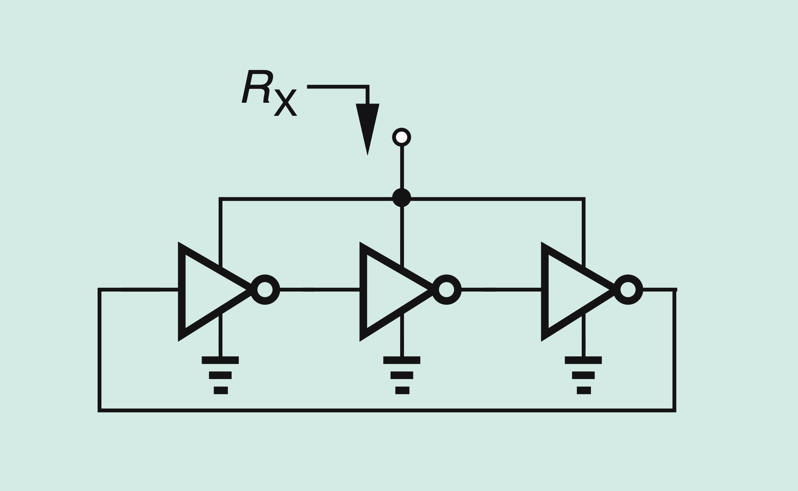

# part2-006-oscillates-change

## Question

For the ring oscillator in the figure, somebody computes the small-signal resistance `RX`
seen looking into the supply node as

```text
RX ~= (1/3) (1/gmn + 1/gmp)
```

where `gmn` and `gmp` are the transconductances of the NMOS and PMOS devices in each
inverter, because each inverter behaves as two diode-connected devices in series.

If the circuit oscillates, does this answer change?

## Figures


